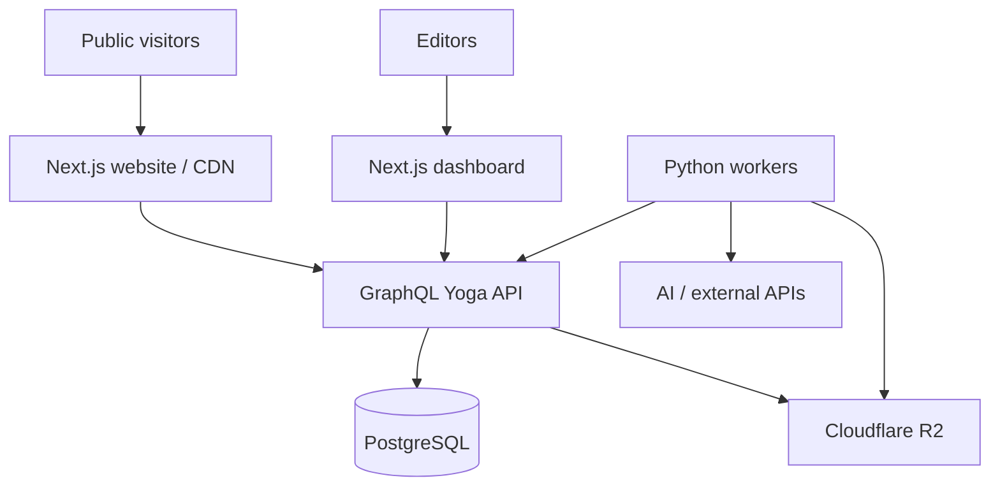

# English Skills Learning Platform — AI Coding Guidelines (v2.0)

> This file is the architectural source of truth for AI coding agents and developers. Build a production-minded English learning platform incrementally. Do not implement every future feature at once.

## 1. Product vision and scope

Build an SEO-friendly English skills learning platform, not a generic blog. Its three first-class domains are Reading, Listening and Lexical Resources. A visitor should be able to learn from a passage, listen to an audio resource, study vocabulary in context and complete exercises. Design for future Writing, Speaking, personalized learning, AI tutoring and audio processing without implementing those features prematurely.

### MVP (manual editorial workflow first)
- Reading: CEFR-tagged passages, topics, comprehension exercises, answer explanations, contextual vocabulary, estimated reading time.
- Listening: audio player, transcript, optional manually timed segments, comprehension exercises, playback speed and replay.
- Lexical resources: words, phrases, collocations, phrasal verbs, idioms, word families, sense-specific definitions, IPA with accent labels, examples and optional pronunciation audio.
- Public navigation by skill, CEFR level (A1–C2), topic and resource type; searchable resources, SEO landing pages and mobile-friendly lessons.
- Anonymous practice with accessible answer feedback; persistent accounts, bookmarks and learning history are a later phase.
- Authenticated editorial dashboard, draft/review/publish, versioned lessons, media upload and preview.
- One authoritative API, PostgreSQL database and independently deployable Python worker foundation.

Do not require AI, TTS, external speech providers, Redis, payments, mobile apps or a separate search cluster for the MVP. Design explicit interfaces for later integration. Do not assume IELTS is the only curriculum; support general English and optional exam labels. English is the initial content language; localized explanations and UI are separate concerns.

## 2. Approved technology stack

| Layer | Technology | Responsibility |
|---|---|---|
| Public web and dashboard | Next.js App Router, React, TypeScript | SEO, rendering and editorial UI |
| Styling | Tailwind CSS | Consistent responsive UI |
| Client state | Zustand, only where needed | Local UI state, not server data |
| API | GraphQL Yoga (TypeScript) | Shared business logic and authorization |
| GraphQL client | urql or Apollo Client (choose one) | Typed client operations and cache |
| GraphQL types | GraphQL Code Generator | Generate types from schema and operations |
| ORM | Drizzle ORM + Drizzle Kit | Schema, migrations and typed database queries |
| Database | PostgreSQL | Durable relational data and jobs |
| Search | PostgreSQL full-text search, pg_trgm, pgvector (later) | Keyword, fuzzy and semantic search |
| Editor | Tiptap | Structured rich text |
| Automation | Python, Pydantic, HTTPX | AI, processing, documents and integrations |
| Media storage | Cloudflare R2 (S3-compatible) | Images, audio, PDFs and video assets |
| Infrastructure | Docker, Docker Compose | Reproducible development and deployment |
| Optional later | Redis + Celery | Higher-throughput background processing |
| Authentication | Auth.js or equivalent OIDC-compatible solution | Editor identity and sessions |

Use stable mutually compatible versions, pinned in manifests and lockfiles. Verify library APIs against official documentation before implementation; never invent dependency versions or APIs. Use pnpm workspaces and a Python virtual environment with a locked dependency set (e.g. uv).

## 3. Architecture and ownership



- The GraphQL API owns business rules, authorization and database writes. Drizzle is the single owner of database schema and migrations.
- Python workers use authenticated GraphQL operations to claim jobs, retrieve inputs and save results. Do not create a competing Python ORM schema or second migration system.
- Python may upload generated media to R2 through restricted credentials or API-issued upload URLs; register resulting assets via GraphQL.
- Keep public and privileged operations separated by authorization, not merely different URLs or client interfaces.
- Never call an AI provider synchronously as part of public lesson rendering.
- Start with one API deployment and one worker process. Split services only when measured operational needs justify it.

## 4. Repository structure

```text
content-platform/
├── AGENTS.md
├── README.md
├── package.json
├── pnpm-workspace.yaml
├── pnpm-lock.yaml
├── .env.example
├── apps/
│   ├── website/           # Next.js public learning platform
│   ├── dashboard/         # Next.js editorial UI
│   └── api/               # GraphQL Yoga server
├── packages/
│   ├── database/          # Drizzle schema, migrations, connection
│   ├── graphql/           # Shared schema, operations, generated types
│   ├── ui/                # Reusable UI components
│   └── config/            # Shared TS/lint configuration
├── services/
│   └── python-engine/
│       ├── pyproject.toml
│       ├── uv.lock
│       ├── src/content_engine/
│       │   ├── config.py
│       │   ├── graphql_client.py
│       │   ├── worker.py
│       │   ├── generators/
│       │   ├── duplicate_detection/
│       │   ├── documents/
│       │   └── integrations/
│       └── tests/
├── infrastructure/
│   └── docker-compose.yml
└── docs/                  # Architecture decisions and runbooks
```

Keep shared packages small. Do not import database or secret-bearing server modules into browser code. Use server-only boundaries in Next.js.

## 5. Domain model and PostgreSQL design

Use UUID primary keys, timestamptz, foreign keys, explicit nullability, constraints and reviewed Drizzle migrations. Use SQL snake_case and TypeScript/GraphQL camelCase. Start with one site but keep a site boundary for future brands. Avoid a generic EAV model or a single giant JSON lesson object. Model relationships and searchable facts relationally; use validated, versioned JSONB only for flexible rich text and exercise payloads.

### 5.1 Shared learning content and taxonomy

| Table | Purpose / core fields |
|---|---|
| sites | id, domain, name, default_locale |
| users, site_memberships | external identity and site-scoped editor roles |
| resources | id, site_id, kind (READING, LISTENING, LEXICAL_COLLECTION, ARTICLE), author_id, archived_at |
| resource_localizations | id, resource_id, site_id, locale, slug, draft_revision_id, published_revision_id; unique site/locale/slug and resource/locale |
| resource_revisions | id, localization_id, revision_no, title, summary, cefr_level, rich_text_json, plain_text, seo fields, status, schema_version, created_by, created_at |
| topics, resource_revision_topics | controlled topic taxonomy and version-specific associations |
| resource_relations | related resources, prerequisite or companion lessons; version where necessary |
| exam_labels | optional exam classifications (IELTS, Cambridge etc.) and revision association |
| media_assets | id, site_id, object_key, mime_type, checksum, bytes, duration_ms, status, rights/provenance metadata |
| revision_media | explicit version-scoped asset references, role and display order |
| audit_events | site_id, actor, action, entity, timestamp |

Each published revision is immutable; drafts can be edited with optimistic concurrency. Publish the entire dependency graph atomically after validation. Public queries must resolve only published snapshots, including exercises, lexical references and audio. Do not let a draft update change a live lesson indirectly. Pin referenced lexical sense revisions and media assets, or explicitly snapshot their public content. Localized slug changes require redirects. A resource's kind is stable; CEFR levels are editorial estimates, not guaranteed learner proficiency.

### 5.2 Reading and listening

| Table | Purpose |
|---|---|
| reading_details | revision_id, passage metadata, word_count, estimated_reading_seconds |
| listening_details | revision_id, transcript rich text, speaker context |
| audio_tracks | id, revision_id, asset_id, locale/accent, label, speed_variant, order |
| transcript_segments | id, audio_track_id, stable segment key, start_ms, end_ms, text, speaker_label, order |
| lexical_annotations | revision_id, stable text block ID, start/end offsets, exact surface text, lexical_sense_revision_id |

Use Tiptap blocks with persistent IDs and a documented Unicode code-point offset convention; test emoji and accented characters. Validate or regenerate annotations when text changes. Transcript timing uses integer milliseconds relative to a particular audio rendition, not wall time. Validate ordering, nonnegative times and end <= duration; permit overlapping speakers where appropriate. Unaligned transcripts remain useful; never invent timings. Audio variants are separate assets with their own timing data.

### 5.3 Lexical knowledge model

| Table | Purpose |
|---|---|
| lexical_entries | id, site_id, language, normalized_headword, display_form, entry_kind (WORD, PHRASE, COLLOCATION, IDIOM, PHRASAL_VERB) |
| lexical_senses | id, entry_id, part_of_speech, stable sense key, published_revision_id |
| lexical_sense_revisions | id, sense_id, revision_no, definition_en, cefr_level, usage/register notes, status |
| lexical_examples | sense_revision_id, sentence, explanation, source/provenance, order |
| lexical_pronunciations | sense_revision_id, locale/accent, ipa, audio_asset_id nullable |
| lexical_glosses | sense_revision_id, locale, translated definition or explanation |
| lexical_relations | source_sense_revision_id, target_sense_revision_id, relation type (synonym, antonym, word_family, related_collocation) |
| collection_items | resource_revision_id, lexical_sense_revision_id, order |

Do not make the spelling globally unique: homographs, parts of speech and senses must be distinguishable. Preserve original display form; normalization is a search aid. Synonyms are sense-specific and not necessarily interchangeable. Separate learner-facing examples from usage explanations. Support multiple UK/US pronunciations, optional audio and future additional locales without schema rewrites.

### 5.4 Reusable assessment engine

| Table | Purpose |
|---|---|
| exercise_sets | id, resource_revision_id, title, instructions, order |
| questions | id, exercise_set_id, type, order, prompt_json, schema_version, points |
| question_options | id, question_id, label/content, order |
| answer_keys | question_id, private validated grading config, accepted answers, explanation |
| practice_attempts (later persistent) | id, user_id, resource_revision_id, started_at, submitted_at, score |
| attempt_answers (later persistent) | attempt_id, question_id, response_json, awarded_points, grading_version |

Initial types: single-choice, true/false/not given, gap fill. Add matching, ordering, multi-select and short-answer through a discriminated union and renderer/grader registry. Validate payload with Zod at API boundary, and equivalent Pydantic schemas for worker exchange. Define deterministic normalization for accepted free-text variants; do not silently accept arbitrary synonyms. Keep answer keys out of pre-submission public queries and client bundles; return feedback through a grading operation. This is practice, not a secure high-stakes examination. Persist attempts against immutable revisions so future edits never change historical scores. Anonymous MVP grading need not persist personal information.

### 5.5 Operational data and future learner features

Retain `content_ideas`, `jobs` and `audit_events`. Jobs include site_id, type, status, payload_json, result_json, attempts, max_attempts, available_at, lease_until, claim_token, idempotency_key and last_error. Add user bookmarks, lesson progress, vocabulary saves, review events and spaced repetition only when accounts are introduced. Store append-only review events and version the scheduling algorithm; keep personalized data private and separable from public editorial data. Future writing submissions and speaking recordings require explicit retention and consent controls.

### 5.6 Integrity, indexing and search

- Site-scope tenant-owned records and enforce composite foreign keys wherever cross-site associations are possible. Deny unauthorized access by default. Roles: owner, admin, editor, reviewer, viewer; future learner roles do not imply editorial privileges.
- Index publication pointers, site/locale/slug, skill/level/topic browsing, foreign keys, normalized headwords and job claims. Use GIN full-text indexes for English passage search and pg_trgm for fuzzy lexical lookup. Preserve exact phrase search and accent/locale metadata. Add pgvector only after evaluating semantic retrieval.
- Use transactions for publish, revision creation and job claim/completion. Store binary objects in R2, not PostgreSQL. Retain assets referenced by published or historical revisions; garbage-collect only verified unreferenced objects.
- Seed original examples of one Reading lesson, one Listening lesson with licensed or original audio, one lexical collection and reusable exercises. Never fabricate audio files or claim alignment when none exists.

## 6. GraphQL contract

Use schema-first or code-first consistently; choose schema-first for this project unless an architecture decision records otherwise. Define typed inputs, enums, pagination, explicit nullability and predictable errors. Keep resolvers thin: validate, authorize, invoke a service, return a typed result. Services own transactions and business rules.

Illustrative public operations (adapt names to the implemented schema):

```graphql
query BrowseResources($filter: ResourceFilter!, $first: Int!, $after: String) {
  publishedResources(filter: $filter, first: $first, after: $after) {
    nodes { id slug title kind cefrLevel summary }
    pageInfo { endCursor hasNextPage }
  }
}
```

Required public queries: publishedResources, resourceBySlug, lexicalSearch, lexicalEntryById, topics, exerciseSet. Required public mutation: gradePractice (bounded inputs, server-side scoring, no answer key before submission). Editorial mutations: createResource, updateDraft, submitForReview, publishResource, archiveResource, manageLexicalSense, createUpload, registerMedia. Worker mutations: enqueueJob, claimJob, renewJobLease, completeJob, failJob. Use GraphQL interfaces/unions for typed resource variants and exercise types; avoid exposing arbitrary JSON as the entire API.

- Validate all input at API boundaries. Never trust siteId or actorId from the client without checking identity and membership.
- Use cursor pagination with stable ordering and a bounded page size (e.g. 50). Avoid unbounded nested lists.
- Prevent N+1 queries using batching/DataLoader or intentional relational queries. Request-scope any loader cache; never share private results across users.
- Limit request size, operation depth/complexity and execution time; rate-limit sensitive mutations and public search. Consider persisted operations for public clients.
- Use generated TypeScript types; avoid `any`. Do not manually edit generated files.
- Keep private fields out of public GraphQL responses, even if the dashboard needs them.
- Use structured error codes (UNAUTHENTICATED, FORBIDDEN, VALIDATION_ERROR, CONFLICT, NOT_FOUND); avoid exposing SQL, tokens or stack traces.

## 7. Next.js frontend and SEO

Public pages use Server Components by default. Client Components are for interactive controls and the editor. Fetch public content from GraphQL server-side; avoid fetching the entire resource list in the browser. Prefer static generation or ISR for published content where appropriate. Implement explicit caching and revalidation using the APIs supported by the installed Next.js version.

- Route example: `/[locale]/reading/[slug]`. Resolve site from a trusted domain mapping, not an arbitrary unvalidated request header.
- On successful publish/unpublish, trigger authenticated cache invalidation for affected lesson, listing, topic, level and sitemap routes. Provide a retry mechanism for failed invalidation.
- Cache keys must include site and locale; never cache authenticated dashboard or draft preview data publicly.
- Use canonical URLs, locale alternates/hreflang, Open Graph metadata, appropriate, truthful structured data, sitemap and RSS; exclude drafts and private routes.
- Render rich content safely; sanitize HTML, validate Tiptap nodes and URL protocols, and prohibit arbitrary executable markup. Treat AI-generated content as untrusted input.
- Provide loading, empty and error states, keyboard accessibility, semantic HTML, responsive design, alt text and stable layout for images.
- Use Zustand only for client UI state; avoid duplicating GraphQL server-state caches.

### Learning UI and routes

Suggested routes: `/reading`, `/reading/[slug]`, `/listening`, `/listening/[slug]`, `/vocabulary`, `/vocabulary/[slug]`, `/lexicon/[id]`, `/topics/[slug]`, `/levels/[level]`. Use a canonical slug/ID strategy and avoid indexing duplicate filter permutations. Public lesson text should be server-rendered; interactive audio player, transcript highlighting, vocabulary popovers and exercise controls are client islands. Build shared `LessonLayout`, `RichTextRenderer`, `AudioPlayer`, `TranscriptViewer`, `LexicalCard`, `ExerciseRenderer` and `AnswerFeedback` components; keep domain data out of Zustand. Use accessible controls, focus management, keyboard navigation, semantic landmarks and mobile layouts. Test WCAG 2.2 AA-oriented interactions. Never bundle private answer keys, draft content or AI credentials into public pages. Cache only public revision data; invalidate by resource and dependent taxonomy on publish, not on draft save. Avoid autoplay and unnecessary audio preloads. 

## 8. Python automation engine

Python handles slow or specialized tasks: topic generation, drafting, similarity checks, translation assistance, PDF/DOCX creation, permitted external integrations and analytics. It is not required to render the learning website or implement routine CRUD.

Use Pydantic models for job payloads/results, HTTPX for GraphQL and external HTTP, structured logging, dependency injection and pytest. Optional libraries: python-docx, ReportLab, Pillow, sentence-transformers; install only when required. FastAPI is optional if the worker later needs HTTP endpoints; it is not necessary for a polling worker.

### Job lifecycle

```text
QUEUED -> RUNNING -> SUCCEEDED
                  -> QUEUED (retry after backoff)
                  -> FAILED (attempts exhausted)
QUEUED -> CANCELLED
```

- Start with a PostgreSQL-backed jobs table; implement atomic claiming in the API using a transaction and row locking (FOR UPDATE SKIP LOCKED), not a separate read then update.
- Claim tokens and leases prevent stale workers from completing reclaimed jobs. Renew leases for long-running work. Recover expired jobs safely and count attempts consistently.
- Use a unique site-scoped idempotency key and idempotent result mutations. Assume at-least-once delivery, not exactly-once execution.
- Retry transient failures with bounded exponential backoff and jitter; classify permanent validation failures separately. Apply request timeouts and provider rate limits.
- Store provider/model identifiers, prompt version, generation timestamp and approximate cost where available. Avoid secrets or sensitive content in logs.
- Save generated learning resources as DRAFT only. Require human review for factual accuracy, educational quality, originality, citations and publishing approval.
- Move to Redis/Celery only after measuring throughput or scheduling requirements; preserve job semantics when migrating.

### Duplicate detection (later phase)
1. Normalize text and check exact duplicate titles/hashes, scoped by site and locale.
2. Use pg_trgm for fuzzy lexical matching with appropriate indexes.
3. Generate embeddings with a versioned embedding model and use pgvector for semantic candidates; fix dimensions to the chosen model and select compatible distance/index operators.
4. Calibrate thresholds against reviewed examples; do not use a universal similarity cutoff or automatically reject every similar topic.
5. Record matches and allow editors to approve genuinely distinct coverage. Similarity is not a substitute for originality or plagiarism review.

### AI-ready learning services (later, not MVP dependencies)

Use explicit adapters for LLM, TTS, STT, embedding and alignment providers. Keep prompt templates versioned and validate structured outputs against domain schemas before saving. Jobs must reference exact input revision IDs. If an editor changes the draft during generation, store results separately and require explicit merge/approval; never overwrite newer work. Evaluate content for CEFR appropriateness, factual accuracy, lexical sense accuracy, answer ambiguity and pedagogical usefulness. AI may suggest definitions, questions, explanations and lesson recommendations, but never silently publish or replace editorially approved answers. Track token/audio usage, per-job cost ceilings, rate limits and provider failures. Do not send personal learner data or recordings to a provider without a documented lawful basis, appropriate consent where required and retention controls. Future interactive tutoring should use a separate bounded streaming endpoint if necessary; GraphQL remains the authoritative domain API.

## 9. Cloudflare R2 media and audio architecture

Use private buckets by default, scoped credentials and short-lived presigned uploads. Public published assets may be served through an explicitly configured public bucket/domain or controlled delivery layer. Draft assets remain private. Validate file type, signature, size, ownership and upload completion; sanitize names, disallow executable files, and use random object keys. Set CORS narrowly. Do not expose access keys to the browser. Clean orphaned uploads using an audited retention policy. Keep metadata and actual object deletion consistent with retryable jobs.

### Audio delivery and processing

- Use native HTML audio with accessible custom controls as needed: play/pause, seek, elapsed/duration, playback speed, replay and keyboard controls. Preserve pitch when supported. No autoplay. Provide readable transcripts and optional synchronized highlighting; retain manual seek even without alignment.
- Store master and derived audio separately, with MIME, codec, duration, checksum, byte length, source/license, processing status and immutable object key. Use MP3 or another browser-tested delivery format; support HTTP Range requests, correct Content-Type, CORS and CDN caching. Do not stream bytes through GraphQL or the Next.js API. Use direct upload and direct CDN delivery or short-lived URLs for private assets.
- Future Python media jobs: probe/validate with ffprobe, transcode with FFmpeg, optional loudness normalization, waveform peaks, speech-to-text, text-to-speech and forced alignment. Treat FFmpeg as an explicitly pinned system dependency in the worker image. Validate duration/size limits; use temporary isolated directories, safe argument arrays, no shell interpolation, and cleanup.
- Define provider-neutral interfaces for TTS, STT, alignment and embeddings. Persist provider, model, voice ID, accent, settings, input hash, job status and cost metadata. Cache identical authorized generation requests by idempotency key; never assume all vendors offer timings. Publish generated audio only after editorial checks; use licensed voices and consent for voice cloning. Provide fallback to manual uploads and transcripts if providers are unavailable.

## 10. Security and configuration

- Authenticate editors using the chosen auth solution; validate credentials/session tokens at the API. Workers use separate narrowly scoped service credentials. Do not trust browser-supplied roles.
- Enforce authorization on every protected operation and entity; test cross-tenant isolation. Consider PostgreSQL RLS as defense in depth, not a substitute for API checks.
- Protect cookie-authenticated mutations against CSRF; use secure HttpOnly cookies where applicable, strict CORS and HTTPS in production.
- Use parameterized SQL through Drizzle; validate inputs and sanitize rich text. Restrict external URL fetching against SSRF, including redirects/private networks.
- Keep secrets in environment variables or secret managers. Commit `.env.example` with placeholders only. Never use `NEXT_PUBLIC_` for credentials.
- Use least-privilege database roles, connection pooling, backups and tested restore procedures. Separate development, test and production databases.

Suggested environment contract (validate at startup; distribute only variables needed by each service):

```dotenv
DATABASE_URL=
GRAPHQL_API_URL=
AUTH_SECRET=
WORKER_SERVICE_TOKEN=
REVALIDATION_SECRET=
R2_ACCOUNT_ID=
R2_ACCESS_KEY_ID=
R2_SECRET_ACCESS_KEY=
R2_BUCKET_NAME=
R2_PUBLIC_BASE_URL=
AI_API_KEY=
AI_MODEL=
EMBEDDING_MODEL=
LOG_LEVEL=info
```

Add provider-specific auth settings after selecting the provider. Never invent or print real credentials.

## 11. Testing, observability and performance

| Area | Required coverage |
|---|---|
| TypeScript | Type checking, lint, unit tests for services and validation |
| GraphQL | Integration tests against real test PostgreSQL; authorization, pagination, publish and job mutations |
| Python | pytest; mocked providers, job retry/idempotency and error handling |
| End-to-end | Playwright: login, create draft, preview, publish and view public lesson; complete exercise and play audio |
| Security | Cross-site access denial, draft/answer leakage, malicious rich text, invalid upload, stale worker lease, cross-user attempt access |
| Deployment | Migrations, health checks, smoke tests and restore rehearsal |

Use structured logs with request/job IDs, timings and safe error codes. Measure public page latency, cache hit rate, database query latency, job queue age, failure rate and AI cost. Establish baselines with realistic data and traffic. Do not claim arbitrary throughput or optimize without measurement. Use CI to run lint, type checks, tests and builds before merge.

## 12. Docker and deployment

Local Docker Compose should provide PostgreSQL, API, website, dashboard and Python worker, with health checks and persistent database volumes. Use a PostgreSQL image supporting pgvector when that extension is introduced; enable extensions through reviewed migrations. R2 can use real development credentials or an explicitly configured local S3-compatible emulator.

Production may deploy Next.js to Vercel or containers, API and workers to long-running container hosting, PostgreSQL to a managed provider or backed-up server, and media to R2. Do not run continuous polling workers in short-lived serverless request handlers. Run migrations as a controlled deployment step, not concurrently from every replica. Use separate deployment environments, TLS, health/readiness checks, graceful worker shutdown and rollback procedures.

## 13. Implementation phases and acceptance criteria

| Phase | Deliverable | Done when |
|---|---|---|
| 0 | Workspace, manifests, Docker, env validation, CI | Clean checkout starts core services; health checks pass |
| 1 | Shared resource model, revisions, taxonomy, lexicon, typed API | Fresh DB migrates; fixtures and isolation tests pass |
| 2 | Reading vertical slice, dashboard, Tiptap, public SEO, exercises | Editor publishes a passage; learner reads, studies vocabulary and receives correct grading; drafts stay private |
| 3 | Listening and lexical resource vertical slices | Audio plays, transcript is readable, optional timing works, sense lookup and collections work; all three domains use shared components |
| 4 | Python job worker, media processing and editorial AI drafts | Retry, lease, idempotency, provider failure and revision-safe attachment tests pass |
| 5 | Learner accounts, bookmarks, progress and vocabulary review | Personal records are isolated, deletable and tied to exact revisions |
| 6 | Advanced AI, semantic search, adaptive practice, writing/speaking experiments | Quality, privacy, cost and accessibility gates pass before release |

Phase 0–3 is the MVP. Deliver small vertical slices and avoid scaffolding every future feature. Do not add microservices, Redis, AI or vector indexing merely because they appear in this roadmap.

## 14. Mandatory rules for AI coding agents

1. Read this file and inspect the existing repository before changing code. Existing working implementation takes precedence over speculative scaffolding; report conflicts with this guide.
2. Implement the requested phase only. State assumptions and affected files briefly. Preserve existing functionality and avoid unrelated refactors.
3. Use strict TypeScript, typed Python, explicit interfaces at boundaries, meaningful names and small focused functions. Avoid unnecessary abstraction and duplicate logic.
4. Verify library compatibility and use real APIs; never fabricate working integrations, keys, benchmark results or test results.
5. Centralize business logic in API services. Do not bypass authorization or schema ownership for convenience.
6. Add tests for new behavior and regression risks. Run relevant checks, report actual results and explain anything not run.
7. Never reset databases, delete user content, overwrite secrets, deploy to production or perform destructive migrations without explicit authorization.
8. For changes to schema, API contracts or deployment configuration, update migrations, generated types, environment examples and documentation as applicable.
9. Do not store secrets in generated examples, logs, fixtures or repository files. Use placeholders and clear setup instructions.
10. Finish each task with a concise summary, files changed, commands/checks performed, known limitations and recommended next step.

## 15. First prompt to an AI coding agent

> Read AGENTS.md and inspect the repository. Implement Phase 0 only: initialize a pnpm TypeScript monorepo with Next.js website and dashboard, GraphQL Yoga API, shared Drizzle database package, and a Python worker skeleton using locked dependencies. Set up Docker Compose, environment validation, health checks, lint/typecheck/test scripts and a README with verified local startup instructions. Use compatible stable dependencies. Do not implement AI generation, embeddings, Redis, learning modules, AI/audio integrations or production deployments yet. If the repository already contains code, integrate with it rather than overwriting it. Run available checks and report actual results. Stop when Phase 0 acceptance criteria are met.

---
Architecture principle: **one content database, one authoritative API, independent public and editorial experiences, and a dedicated Python automation engine. Start simple, preserve clear ownership, and scale based on evidence.**

## 16. Domain boundaries and future extension rules

Organize API services and dashboard features by `resources`, `reading`, `listening`, `lexicon`, `assessment`, `media`, `identity`, `jobs` and later `learning-progress`. Each module owns its validation and services; shared resource publishing coordinates via explicit contracts. Keep Drizzle migrations in one package. Add a new skill by defining a resource kind, typed detail model, GraphQL variant, public renderer, editorial form and validation tests, rather than cloning the entire platform. Use feature flags for incomplete capabilities. Document architectural changes in ADRs.

Required regression tests include exact published-revision isolation, pinned lexical references, correct sense-specific lookups, transcript timing per rendition, audio range playback, question grading and answer-key exclusion, accessible keyboard interactions and revision-safe AI job completion.
