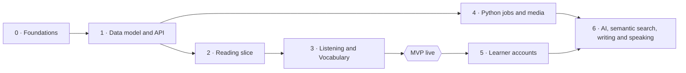

# English Skills Platform — Build Roadmap

> Source: `AGENTS-English-Skills.md` v2.0 (the architecture guide).
> Status: **draft**. The stack is decided: a TypeScript API (GraphQL Yoga + Drizzle), with Python for background jobs only. The other open decisions at the end must be settled before Phase 0 starts.
> Last updated: 2026-11-24.

The guide, turned into a build order: seven phases, from 0 to 6.

- **Phases 0–3 are the MVP**, the first public version. It has Reading, Listening and Vocabulary lessons that anyone can use without an account. Editors write the lessons in a dashboard.
- **Each phase ships one small working slice, then stops.** Nothing from a later phase is built early.

**Principle:** one content database and one authoritative API. The public site and the editorial dashboard are separate. A Python engine does the slow work. Start simple, and split things up only when measurements show a need.

---

## Phases and dependencies

Phase 4 needs only the API from Phase 1, so it can start once the MVP is stable. Phase 6 needs both the workers and learner accounts.

---

## Stack (fixed by the guide, confirmed 2026-11-24)

| Layer | Technology | Owns |
|---|---|---|
| Public site and dashboard | Next.js (App Router), React, TypeScript, Tailwind | Pages, SEO, editor screens |
| API | GraphQL Yoga, schema-first, generated types | All business rules, permissions and writes |
| Database | PostgreSQL + Drizzle ORM / Drizzle Kit | The only schema and the only migrations |
| Search | Postgres full-text + pg_trgm (pgvector later) | Passage search, fuzzy word lookup |
| Rich text | Tiptap, blocks with permanent IDs | Passages, transcripts, explanations |
| Slow work | Python + Pydantic + HTTPX, uv | Jobs, media, AI drafts; talks only to the API |
| Media | Cloudflare R2 (S3-compatible) | Audio, images, PDFs |
| Sign-in | Auth.js or another OIDC solution | Editor identity and sessions |
| Running it | Docker Compose, pnpm workspaces | Same setup locally and in production |

---

## Phase 0 — Foundations · MVP

**Goal:** a clean checkout starts every core service with one command, and every check runs automatically.

**Build**
- A pnpm monorepo:
  - apps: `apps/website`, `apps/dashboard`, `apps/api`;
  - packages: `database` (Drizzle), `graphql`, `ui`, `config`.
- A Python worker skeleton with a locked uv setup.
- Docker Compose running Postgres, the API, website, dashboard and worker, each with a health check.
- Environment settings checked at startup; `.env.example` holds placeholders only.
- CI that runs lint, type checks, tests and the build on every push.
- A README with start-up steps that have been tested.

**Done when**
- [ ] A fresh checkout plus one command starts everything.
- [ ] All health checks pass.
- [ ] CI passes on a branch.

**Not yet:** any lesson, AI, Redis or deployment.

**Branches:** `feature/workspace`, `feature/docker`, `feature/ci`

---

## Phase 1 — Data model and API · MVP

**Goal:** one shared shape for all content, versioned and safe to publish, behind a typed API with permissions.

**Build**
- **Identity:** sites, users and site memberships, with the roles owner, admin, editor, reviewer and viewer. Editors sign in, and their sessions are kept on the server.
- **Lessons (resources):** resources, localizations and revisions. Drafts can be edited; published revisions are frozen.
- **Supporting tables:** topics, exam labels, related resources, media records and audit events.
- **Lexicon:** entries, senses, sense revisions, examples, pronunciations and relations.
- **Exercises:** exercise sets, questions, options and private answer keys.
- **GraphQL schema:** typed errors, cursor pagination (at most 50 items a page), and depth and size limits.
- **Seed data:** one original reading, one listening and one word collection.

**Done when**
- [ ] A fresh database migrates cleanly.
- [ ] The seed data loads.
- [ ] Tests prove that:
  - one site can't see another site's data;
  - public queries return only published revisions;
  - answer keys never appear before grading.

**Not yet:** public pages, dashboard screens, learner accounts.

**Branches:** `feature/identity`, `feature/resource-model`, `feature/lexicon-model`, `feature/assessment-model`, `feature/graphql-api`

---

## Phase 2 — Reading, end to end · MVP

**Goal:** an editor writes and publishes a reading passage. A visitor reads it, studies its words and does the exercises.

**Build**
- **Dashboard:** sign in, create a draft in Tiptap, submit it for review, preview it, publish it.
- **Public pages:** `/reading`, `/reading/[slug]`, plus level and topic pages, all rendered on the server.
- **Vocabulary pop-ups**, each linked to the exact sense of the word in the text.
- **Exercises:** single choice, true/false/not given, and gap fill, all graded on the server.
- **SEO:** canonical links, a sitemap and metadata. Drafts are never indexed.
- **Cache refresh on publish**, retried if it fails.
- **Shared components:** `LessonLayout`, `RichTextRenderer`, `LexicalCard`, `ExerciseRenderer`, `AnswerFeedback`.

**Done when**
- [ ] A Playwright test runs the whole path: log in, draft, preview, publish, view, complete the exercise.
- [ ] Drafts stay private.
- [ ] Malicious rich text is blocked.
- [ ] Everything works by keyboard.

**Not yet:** audio, saved progress.

**Branches:** `feature/dashboard-editor`, `feature/reading-public`, `feature/exercises`, `feature/seo`

---

## Phase 3 — Listening and Vocabulary · MVP

**Goal:** the other two skills, built from the same shared components. This phase ends the MVP.

**Build**
- **Media upload:** files go directly to storage through short-lived links. Each file's type, size and content are checked.
- **`AudioPlayer`:** play, seek, speed, replay and keyboard controls. No autoplay.
- **`TranscriptViewer`:** timings are optional and entered by hand. They are never invented.
- **Pages:** `/listening`, `/vocabulary`, `/lexicon/[id]`.
- **Word search:** exact phrases plus fuzzy matches.
- **Pronunciations:** UK and US, with optional audio.

**Done when**
- [ ] Audio plays and seeks, because HTTP range requests work.
- [ ] Transcripts read well with or without timings.
- [ ] Looking up a word finds the right sense.
- [ ] All three skills share the same components.

**Not yet:** generated audio, speech-to-text.

**Branches:** `feature/media-upload`, `feature/listening`, `feature/lexicon-public`

---

## Phase 4 — Python jobs, media processing, AI drafts · after MVP

**Goal:** slow work runs in the background and is retried safely. AI output only ever arrives as a draft, for a person to check.

**Build**
- **Jobs table:** atomic claiming (`FOR UPDATE SKIP LOCKED`), leases, and retries with backoff.
- **Python worker:** it talks only to the API, using its own narrow service key.
- **Audio jobs:** check files with ffprobe, convert them with FFmpeg, normalise loudness, draw waveforms.
- **Provider-neutral adapters** for AI, text-to-speech, speech-to-text and alignment.
- **AI drafts:** saved as DRAFT and linked to the exact revision they came from.

**Done when**
- [ ] Tests pass for retries, stale leases, duplicate jobs and provider failure.
- [ ] A job never overwrites an editor's newer work.

**Not yet:** Redis or Celery, unless a measured need appears.

**Branches:** `feature/jobs`, `feature/python-worker`, `feature/media-jobs`, `feature/ai-drafts`

---

## Phase 5 — Learner accounts and progress · after MVP

**Goal:** learners can sign up, save lessons, keep their progress and review words.

**Build**
- **Sign-up and login:** Google, email link or password. The diagrams are in the Phase 1 plan page.
- **Under-16s:** an age check, then parent approval.
- **Learner records:** bookmarks, lesson progress, saved words, and attempts tied to exact revisions.
- **Word review:** spaced review built from append-only review events, with a versioned schedule.
- **Account controls:** "Delete my account" and "Export my data".

**Done when**
- [ ] A learner can't see another learner's records.
- [ ] Deleting an account removes all of its data.
- [ ] Old scores never change when a lesson is edited.

**Not yet:** personalised recommendations.

**Branches:** `feature/learner-accounts`, `feature/progress`, `feature/word-review`

---

## Phase 6 — AI tutoring, semantic search, writing and speaking · after MVP

**Goal:** the advanced features, each released only after quality, privacy, cost and accessibility checks.

**Build**
- pgvector semantic search and duplicate-topic detection.
- Adaptive practice, and AI tutoring through a separate bounded endpoint.
- Writing and speaking experiments, with consent and retention rules.

**Done when**
- [ ] Each feature passes its quality, privacy, cost and accessibility gate.

---

## Open decisions (before Phase 0)

The guide differs from earlier discussions in seven places. Each needs a yes or no.

| # | Topic | The guide says | Earlier discussion | Decision |
|---|---|---|---|---|
| 1 | Stack | A TypeScript API (GraphQL Yoga + Drizzle). Drizzle is the only schema owner, so there is no Django. Python is for the background engine only. | Leaning to Django | ✔ **Decided 2026-11-24: TypeScript API.** Django dropped. |
| 2 | API | GraphQL, with depth, size and rate limits | GraphQL not needed | ✔ **Decided 2026-11-24: GraphQL Yoga**, as the guide says. |
| 3 | Learner accounts | Phase 5. The MVP is anonymous practice, and only editors sign in, so there is no children's data at launch. | Sign-up in Phase 1 | ☐ |
| 4 | Roles | owner, admin, editor, reviewer, viewer | Owner and Editor | ☐ |
| 5 | Paid services | Media on Cloudflare R2 (it has a free tier); Vercel is optional | Avoid paid plans. Use MinIO locally, and containers on your own server in production. Self-hosting MinIO in production as well needs a decision record. | ☐ |
| 6 | Client-side rule | Auth.js with database sessions; HttpOnly cookie only; no `NEXT_PUBLIC_` secrets | Never store accounts on the client | ✔ compatible |
| 7 | Folder name | `content-platform/` | `English Learning/`, kept until the site has a name | ☐ |

## Working rules

- Every piece of work goes on its own `feature/…` or `fix/…` branch. It is tested there, then merged to `main` only on approval.
- No code until each phase is approved.
- Secrets live only in environment settings, never in the repository, logs or fixtures.
